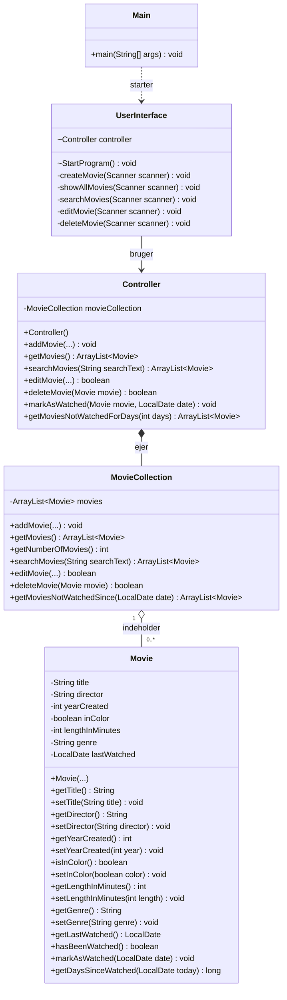

# Klassediagram – Filmsamling

Dette klassediagram viser klasserne i vores Filmsamling-projekt,
deres attributter, metoder og relationer.

## Forklaring

- **Main:** Starter programmet.
- **UserInterface:** Viser menuen og modtager brugerens input.
- **Controller:** Forbinder brugerfladen med filmsamlingen.
- **MovieCollection:** Gemmer film og håndterer søgning, redigering og sletning.
- **Movie:** Indeholder oplysninger om en film og datoen, hvor den sidst blev set.

## UML-symboler

- `+` betyder public.
- `-` betyder private.
- `~` betyder package-private.
- `-->` viser en relation mellem klasser.
- `*--` viser komposition.
- `o--` viser aggregation.
