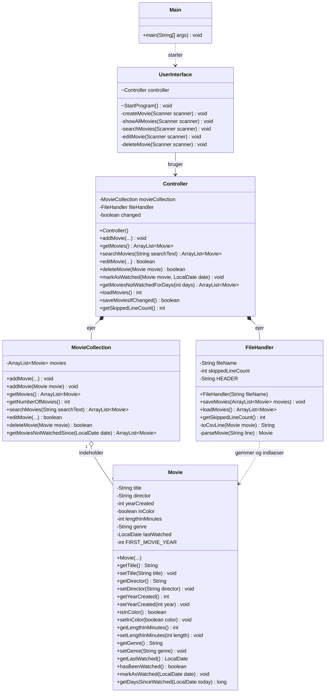

# Klassediagram – Filmsamling

Dette klassediagram viser klasserne i vores Filmsamling-projekt, deres attributter, metoder og relationer. Diagrammet er opdateret med filhåndtering fra Del 7 (US13 og US14).

## Forklaring

- **Main:** Starter programmet.
- **UserInterface:** Viser menuen, modtager brugerens input og skal indlæse og gemme filmsamlingen ved opstart og afslutning.
- **Controller:** Forbinder brugerfladen med filmsamlingen og filhåndteringen. Holder styr på ændringer med `changed`.
- **MovieCollection:** Gemmer film og håndterer søgning, redigering og sletning. Kan også tilføje et eksisterende `Movie`-objekt.
- **Movie:** Indeholder oplysninger om en film, validerer værdier og holder styr på datoen, hvor filmen sidst blev set.
- **FileHandler:** Gemmer film i CSV-format, indlæser dem igen og tæller ugyldige linjer.

## UML-symboler

- `+` betyder public.
- `-` betyder private.
- `~` betyder package-private.
- `-->` viser en relation mellem klasser.
- `..>` viser en afhængighed.
- `*--` viser komposition.
- `o--` viser aggregation.
